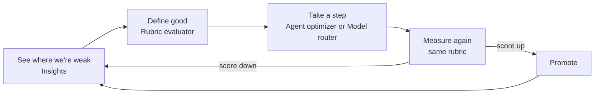

# LAB663 narrative

The story we tell, in one place. We use it to keep the lab, the slides and the talk track saying the same thing. Each section is short and can be lifted straight into a slide.

> This is a living file. We add to it whenever we find a better way to explain something.

## The one-line story

We climb the hill together: build an agent, measure it, then improve it one lever at a time, and keep a step only when the evidence says it helped.

## The loop

Every climb repeats the same four moves. Each of our four Foundry features answers one of them.

| Feature | The question it answers | Without it |
|---|---|---|
| **Insights** | Where are we weak, and why? | We guess what to fix |
| **Rubric evaluator** | How high are we, as a number? | We can't tell if a change helped |
| **Agent optimizer** | How do we climb on quality? | We hand-tune prompts and hope |
| **Model router** | How do we climb on cost? | We overpay for one big model, or under-deliver on a small one |

Insights give us the direction and the rubric is our altitude meter. The optimizer climbs on quality and the router climbs on cost, and both use the rubric to decide whether a step was real.

## Six ways to lose a customer's trust

This is the spine of the data. Each is a failure we can see, name and fix, and each one maps to an insight cluster, a rubric criterion and a lever.

| # | Way we lose trust | Example | Who fixes it |
|---|---|---|---|
| 1 | **Wrong product**: mixes up similar items | TrailMaster X4 vs Alpine Explorer | Instructions plus file search (v1) |
| 2 | **Overclaiming**: "water-resistant" becomes "waterproof" | Summit Breeze Jacket | Optimizer (v2) |
| 3 | **Making things up**: answers when the manual is silent | Exact shoe weight | Optimizer (v2) |
| 4 | **Going along with a wrong premise** | "What colors does the EcoFire tent come in?" | Optimizer (v2) |
| 5 | **Out of lane**: off-topic requests | A hot chocolate recipe | Optimizer (v2) |
| 6 | **Not useful**: weak comparisons and recommendations | Family tent, tent comparison | Model choice (router, v3) |

## The picture that tells the story

A **heatmap**: rows are the six ways, columns are v0 to v3. Cells start dark and light up as we climb. One slide, the whole talk.

We also tag every case easy or hard. The router story needs it: easy lookups go to small models, hard comparisons go to strong ones, and quality holds while cost drops.

## The versions

| Version | What changes | Lever |
|---|---|---|
| **v0** | Infra creates a generic "you are a helpful agent" | Starting camp |
| **v1** | We update the instructions with the SDK so it knows TrailMate | Instructions |
| **v2** | The agent optimizer improves the prompt, using our rubric | Quality |
| **v3** | We right-size the model with the router | Cost |

One lever at a time, so we always know what moved the score.

## Teaching beats

Each module ends with something we built, broke, fixed and can explain.

| Module | We build | We break | We fix and learn |
|---|---|---|---|
| Make it work | The v1 agent, a set of traces | We see v0 and v1 fail in six ways | Insights turn the failures into a list |
| Make it better | A rubric from the traces | An over-eager candidate refuses everything | The guard cases catch it, and we promote the right one |
| Make it optimal | A router-backed agent | A cheap edition drops quality on hard cases | The same rubric tells us which edition to keep |

## Rules we keep, so the climb is believable

- **One scoreboard.** The rubric is frozen after we build it, and we score every version with it.
- **A held-out test set.** The optimizer never sees it. That's how we tell improvement from memorization.
- **Never shrink the tests to recover a score.** A drop on a harder set means coverage improved.
- **Evidence before opinion.** We look at the trace, the eval or the insight first.
- **Every claim gets a number**, for example "grounding went from 2.8 to 4.1".

## Talk track ideas

Lines we like. Add more as we find them.

- "We don't ask whether the agent is good. We ask how high it is, and which way is up."
- "Insights show us the slope. The rubric tells us how high we are. The optimizer and the router are our two ways to climb."
- "A step only counts if the same ruler says it does."

## Open questions for the story

- Which single slide opens the session?
- Do we reveal the heatmap at the start (empty) or only at the end?
- What is our v3 headline: cost saved, or quality held, or both?
