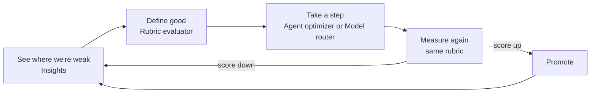

# LAB663 narrative

The story we tell, in one place. We use it to keep the lab, the slides and the talk track saying the same thing. Each section is short enough to lift straight onto a slide.

> This is a living file. We add to it whenever we find a better way to explain something.

 

## The one-line story

We climb the hill together: build an agent, measure it, then improve it one lever at a time, and keep a step only when the evidence says it helped.

 

## The loop

Every climb repeats the same four moves. Each of our four Foundry features answers one of them.

| Feature | The question it answers | Without it |
|---|---|---|
| **Insights** | Where are we weak, and why? | We guess what to fix |
| **Rubric evaluator** | How high are we, as a number? | We can't tell if a change helped |
| **Agent optimizer** | How do we climb on quality? | We hand-tune prompts and hope |
| **Model router** | How do we climb on cost? | We overpay for one big model, or under-deliver on a small one |

 

## Six ways to lose a customer's trust

The spine of the data. Each one is a failure we can see, name and fix.

| # | Way we lose trust | Example | Who fixes it |
|---|---|---|---|
| 1 | **Wrong product**: mixes up similar items | TrailMaster X4 vs Alpine Explorer | Instructions plus file search (v1) |
| 2 | **Overclaiming**: "water-resistant" becomes "waterproof" | Summit Breeze Jacket | Optimizer (v2) |
| 3 | **Making things up**: answers when the manual is silent | Exact shoe weight | Optimizer (v2) |
| 4 | **Going along with a wrong premise** | "What colors does the EcoFire *tent* come in?" | Optimizer (v2) |
| 5 | **Out of lane**: answers off-topic requests | A hot chocolate recipe | Optimizer (v2) |
| 6 | **Not useful**: weak comparisons and recommendations | Which tent for six people? | Model choice (router, v3) |

 

## The picture that tells the story

A **heatmap**: rows are the six ways, columns are v0 to v3. Cells start dark and light up as we climb. One slide, the whole talk.

Every case is also tagged easy, medium or hard. The router story needs it: easy lookups can go to small models, hard comparisons to strong ones.

 

## The versions

| Version | What changes | Lever |
|---|---|---|
| **v0** | `deploy.sh` creates a generic "You are a helpful agent." | Starting camp |
| **v1** | We write better instructions with the SDK | Instructions |
| **v2** | The agent optimizer's best rewrite, promoted | Quality |
| **v3** | Same instructions, a right-sized model from the router | Cost |

One lever at a time, so we always know what moved the score.

 

## The modules: a question and an aha each

Every notebook starts with a question a developer would ask, and ends with the moment it clicks.

| Module | The question | The aha |
|---|---|---|
| **0 · What are we building?** | What are we building, and how will we know it got better? | We're building a repeatable way to *prove* improvement |
| **1 · Set up and validate** | How do I know my setup really works? | "It doesn't work" is useless. "Check 5 failed" is a fix |
| **2 · Choosing a model** | Which model should I use? | Ask which of your questions need the big one |
| **3 · Multi-model vs multi-modal** | What's the difference, and when do I need each? | One is what comes *in*. The other is who handles which *step* |
| **4 · Make it work** | How do I find what's wrong without reading every answer? | Insights turn opinions into patterns with evidence |
| **5 · Make it better** | How do I know it got better, not just different? | The gain we can trust is the one on questions the optimizer never saw |
| **6 · Make it optimal** | Can I cut my model bill without losing quality? | Savings and risk live in different places: easy and hard questions |

 

## Teaching beats

Each module ends with something we built, broke, fixed and can explain.

| Module | We build | We break | We fix and learn |
|---|---|---|---|
| 4 · Make it work | v1 and a set of traces | v0 and v1 fail in named ways | Insights turn the failures into a list |
| 5 · Make it better | A rubric from the traces | An optimizer can win by being timid | Guard cases catch the over-cautious candidate |
| 6 · Make it optimal | A router-backed agent | The cheap edition slips on hard questions | The same rubric tells us which edition to keep |

 

## Rules we keep, so the climb is believable

- **One scoreboard.** The rubric is fixed once we build it, and every version is scored with it.
- **A held-out test set.** The optimizer never sees it. That's how we tell improvement from memorization.
- **Never shrink the tests to recover a score.** A drop on a harder set means coverage improved.
- **Evidence before opinion.** We look at the trace, the eval or the insight first.
- **Every claim gets a number.** Never an invented one. If we haven't measured it, we say so.

 

## Talk track ideas

Lines we like. Add more as we find them.

- "We don't ask whether the agent is good. We ask how high it is, and which way is up."
- "Insights show us the slope. The rubric tells us how high we are. The optimizer and the router are our two ways to climb."
- "A step only counts if the same ruler says it does."
- "Which model is best?" is the wrong question. Ask which of your questions need the big one.

 

## Open questions for the story

- Which single slide opens the session?
- Do we reveal the heatmap at the start (empty) or only at the end?
- What is our v3 headline: cost saved, or quality held, or both?
- We haven't run this live yet. Which numbers on the final slide come from a real run?
