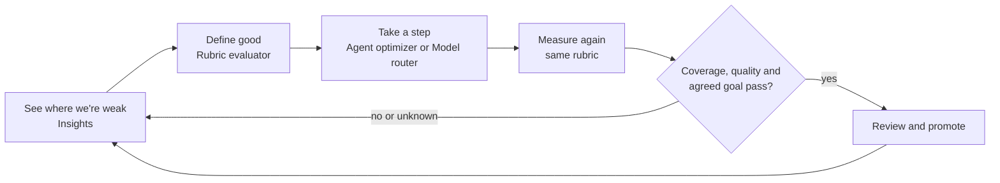

# LAB663 narrative

The story we tell, in one place. We use it to keep the lab, the slides and the talk track saying the same thing. Each section is short enough to lift straight onto a slide.

> This is a living file. We add to it whenever we find a better way to explain something.

 

## The one-line story

We climb the hill together: build an agent, measure it, then improve it one lever at a time, and keep a step only when the evidence says it helped.

 

## The loop

Every climb repeats the same four moves. Each of our four Foundry features answers one of them.

| Feature | The question it answers | Without it |
|---|---|---|
| **Insights** | Where are we weak, and why? | We guess what to fix |
| **Rubric evaluator** | How high are we, as a number? | We can't tell if a change helped |
| **Agent optimizer** | How do we climb on quality? | We hand-tune prompts and hope |
| **Model router** | Can routing improve our quality, cost and latency trade-off? | We have to choose and maintain the routing policy ourselves |

 

## Six ways to lose a customer's trust

The spine of the data. Each one is a failure we can see, name and fix.

| # | Way we lose trust | Example | Lever to investigate |
|---|---|---|---|
| 1 | **Wrong product**: mixes up similar items | TrailMaster X4 vs Alpine Explorer | Instructions (v1); inspect retrieval |
| 2 | **Overclaiming**: "water-resistant" becomes "waterproof" | Summit Breeze Jacket | Optimizer (v2) |
| 3 | **Making things up**: answers when the manual is silent | Exact shoe weight | Optimizer (v2) |
| 4 | **Going along with a wrong premise** | "What colors does the EcoFire *tent* come in?" | Optimizer (v2) |
| 5 | **Out of lane**: answers off-topic requests | A hot chocolate recipe | Optimizer (v2) |
| 6 | **Not useful**: weak comparisons and recommendations | Which tent for six people? | Model choice (router, v3) |

 

## The picture that tells the story

A **heatmap**: rows are the six ways, columns are the measured versions and checkpoints. Cells can improve, stay flat or get worse. A retained baseline is a decision, not a failed presentation. Label rejected candidates rather than implying they were promoted.

Every case is also tagged easy, medium or hard. These are our teaching labels, not the router's decisions or a production traffic forecast. The test set has five easy, five medium and two hard cases.

 

## The versions

| Version | What changes | Lever |
|---|---|---|
| **v0** | Self-guided deployment or the Skillable lifecycle creates a generic "You are a helpful agent." | Starting camp |
| **v1** | We write better instructions with the SDK | Instructions |
| **v2 checkpoint** | Promote the optimizer candidate only after measurement and review; otherwise keep v1 | Quality |
| **v3 checkpoint** | Same instructions and tools; promote a router only if complete evidence supports the trade-off | Model |

One lever at a time, so we always know what moved the score.

 

## The modules: a question and an aha each

Every notebook starts with a question a developer would ask, and ends with the moment it clicks.

| Module | The question | The aha |
|---|---|---|
| **0 · What are we building?** | What are we building, and how will we know it got better? | We're building a repeatable way to *prove* improvement |
| **1 · Set up and validate** | How do I know my setup really works? | "It doesn't work" is useless. "Check 5 failed" is a fix |
| **2 · Choosing a model** | Which model should I use? | Ask which of your questions need the big one |
| **3 · Multi-model vs multi-modal** | What's the difference, and when do I need each? | One is what comes *in*. The other is who handles which *step* |
| **4 · Make it work** | How do I find what's wrong without reading every answer? | Insights turn opinions into patterns with evidence |
| **5 · Make it better** | How do I know it got better, not just different? | The gain we can trust is the one on questions the optimizer never saw |
| **6 · Make it optimal** | Can I cut my model bill without losing quality? | Savings and risk live in different places: easy and hard questions |

 

## Teaching beats

Each module ends with something we built, broke, fixed and can explain.

| Module | We build | We break | We fix and learn |
|---|---|---|---|
| 4 · Make it work | v1 and a set of traces | v0 and v1 fail in named ways | Insights turn the failures into a list |
| 5 · Make it better | A rubric from the traces | An optimizer can win by being timid | Guard cases catch the over-cautious candidate |
| 6 · Make it optimal | A router-backed agent | The cheap edition slips on hard questions | The same rubric tells us which edition to keep |

 

## Rules we keep, so the climb is believable

- **One scoreboard.** The rubric is fixed once we build it, and every version is scored with it.
- **The judge sees the evidence it needs.** Retrieval criteria receive structured tool output, not only the final answer. Pin the evaluator version and inspect its reasons.
- **Complete coverage.** A failed request is not a cheap answer. Missing, errored or skipped cases invalidate a batch; we do not average them away.
- **A held-out test set.** The optimizer never sees it. That's how we tell improvement from memorization.
- **Select on dev, check once on test.** Trying four routers on the held-out set and choosing the winner would turn it into another tuning set.
- **Never shrink the tests to recover a score.** A drop on a harder set means coverage improved.
- **Version a changed measuring stick.** Remeasure every baseline when the dataset or rubric changes; do not compare scores from different sets.
- **Evidence before opinion.** We look at the trace, the eval or the insight first.
- **Every claim gets a number.** Never an invented one. If we haven't measured it, we say so.
- **Tokens are not dollars.** Separate agent and judge usage, account for serving models and cached input, and use verified regional prices. Unknown cost cannot earn a cost-based promotion.

## What the first run actually tells us

The original BAMI notebook outputs are useful failure evidence, not a finished success story. The recorded held-out score moved from 0.53 for v1 to 0.55 for the optimizer candidate, while that candidate's two-repeat spread was 0.05. That does not support a confident improvement claim.

A read-only review on 13 October 2026 also found incomplete router batches in the original development project. In the latest recorded pair of twelve-question runs for each edition:

| Edition | Errored requests across 24 attempts | Comparable complete batch? |
|---|---:|---|
| `mr-default` | 3 | No |
| `mr-cost` | 4 | No |
| `mr-quality` | 5 | No |
| `mr-subset` | 3 | No |

The service reported `TARGET_INVOCATION_FAILED` with underlying HTTP 500 errors. Failures included the easy, answerable warranty guard case `ts-06`, not just hard questions. The records identify failed requests; they do not establish the service-side cause of those errors.

There was a separate measurement problem: the generated rubric included retrieval-quality criteria, but the evaluation supplied only final text. A recorded judge reason explicitly said it could not see retrieved support for an otherwise clear tent comparison. We must correct that input contract and remeasure before attributing score differences to routing policy.

An isolated live check of that contract scored the **same captured tent answer** twice: 0.583 with final text only and 0.887 with structured tool evidence. The judge could inspect the retrieval query and supporting specifications in the second case. This one-answer check confirms an input-contract problem; it is not a model improvement or a new lab benchmark.

The old token-only promotion also hid category losses: the recorded `mr-cost` comparison fell by 0.15 on medium questions and 0.11 on hard ones. Prices were unfilled, so the displayed token reduction was not proof of dollar savings. Actual deployment capacity observed during the review differed between router editions too; a fair latency experiment needs to record capacity, configuration and errors.

The revised lab therefore tests complete coverage, saves per-case reasons and actual deployment settings, selects router candidates on dev, and protects categories and guard cases. It does not promise that a cost- or quality-named mode will win this workload. See Microsoft's guidance on [evaluating model router](https://learn.microsoft.com/azure/foundry/openai/how-to/evaluate-model-router).

## What the isolated rehearsal tells us

A fresh deployment in the requested review tenant reproduced a runtime problem. With the same generic v0 instructions, manuals and structured-evidence rubric, two complete dev repeats on `gpt-5.4` scored all 24 responses. The balanced router errored on 5 of 24 attempts, so the revised helper correctly refused an aggregate score or cost. This is a measurement-path check, not a full optimizer run or held-out benchmark.

We then isolated two failed questions: laptop-compartment size and a heavy-rain jacket recommendation. Both failed twice through the pinned router agent. Direct Responses calls with `mr-default` and `file_search` also returned HTTP 500 for both questions. The same questions completed without the search tool, and `gpt-5.4` completed both with the search tool. This narrows the reproducible problem to the router/file-search path for those requests; the internal service cause still needs investigation.

Removing grounding is **not** a fix. The no-tool laptop answer asserted a 15.6-inch compartment, while the grounded answer identified contradictory manual statements. Keep the tools and frozen questions intact, retain the baseline, and preserve failed request IDs for service investigation.

The complete baseline pair took **213 seconds** in this rehearsal. The router pair ended after 164 seconds but was incomplete, so that is not a demonstrated latency improvement. Module 5 contains several batches plus rubric generation and optimization; its 14-minute allocation and the overall 60-minute beginner journey remain unverified.

## Keep the beginner journey focused

The common thread for all three audiences is a customer-facing decision: should we keep this change? A business decision maker should be able to explain the risk and evidence; a developer should be able to reproduce the versioned calls; an AI engineer should be able to challenge the judge, coverage and comparison.

The 60-minute schedule is a target pending a timed learner rehearsal. Prepare the environment and read Module 0 beforehand. Keep extra reasoning-effort, photo and router-edition experiments optional; do not reduce the frozen evaluation set. While services run, use the **While you wait** boxes in Modules 4 to 6. If the live job exceeds the session, preserve its ID and report a pending decision.

There is also a useful data-quality lesson: the Adventurer Pro manual contains conflicting rain-cover statements, while `pr-04` expects an unqualified "no." Preserve the current dataset during the run, record the ambiguity, and review the answer key with the content owners for the next version. A quote check alone does not resolve conflicting source material.

 

## Talk track ideas

Lines we like. Add more as we find them.

- "We don't ask whether the agent is good. We ask how high it is, and which way is up."
- "Insights show us the slope. The rubric tells us how high we are. The optimizer and the router are our two ways to climb."
- "A step only counts if the same ruler says it does."
- "Which model is best?" is the wrong question. Ask which of your questions need the big one.

 

## Open questions for the story

- Which single slide opens the session?
- Do we reveal the heatmap at the start (empty) or only at the end?
- What is our v3 headline: cost saved, or quality held, or both?
- Which remeasured, complete results belong on the final slide, and which claims remain unverified?
