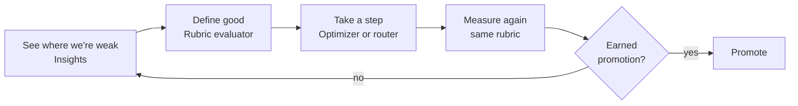

# LAB663 attendee instructions

**Build smarter AI systems with model router and agent optimizer.**

We climb the hill together: build it, measure it, improve it. TrailMate, Contoso Outdoors' product assistant, starts as a plain v0 agent. We find where it loses customer trust, turn "good" into a number with a rubric, let the agent optimizer propose better instructions, and try a model router to cut cost. One lever at a time, with the same measuring stick at every step.

## Choose your path

| Path | For | Start here |
|---|---|---|
| **Skillable** (in-venue) | Ignite attendees in a prepared Skillable lab | [Skillable manual](skillable/README.md) |
| **Self-guided** (at home) | Anyone with their own Azure subscription, in a Codespace or the dev container | [Self-guided walkthrough](self-guided/README.md) |

Both paths run the same notebooks in [`labs/core/`](../labs/core/) and cover the same sections. Self-guided pages are written for reading in VS Code or on GitHub. Skillable pages are the same content as short steps with checkboxes and copy text.

## Modules

| # | Module | Self-guided | Skillable |
|---|---|---|---|
| 0 | Get ready | [00-get-ready.md](self-guided/core/00-get-ready.md) | [core-0-get-ready.md](skillable/core-0-get-ready.md) |
| 1 | Set up and validate | [01-setup-and-validate.md](self-guided/core/01-setup-and-validate.md) | [core-1-setup-and-validate.md](skillable/core-1-setup-and-validate.md) |
| 2 | Choosing a model | [02-model-selection.md](self-guided/core/02-model-selection.md) | [core-2-model-selection.md](skillable/core-2-model-selection.md) |
| 3 | Multi-model vs multi-modal | [03-multi-model-vs-multimodal.md](self-guided/core/03-multi-model-vs-multimodal.md) | [core-3-multi-model-vs-multimodal.md](skillable/core-3-multi-model-vs-multimodal.md) |
| 4 | Make it work | [04-make-it-work.md](self-guided/core/04-make-it-work.md) | [core-4-make-it-work.md](skillable/core-4-make-it-work.md) |
| 5 | Make it better | [05-make-it-better.md](self-guided/core/05-make-it-better.md) | [core-5-make-it-better.md](skillable/core-5-make-it-better.md) |
| 6 | Make it optimal | [06-make-it-optimal.md](self-guided/core/06-make-it-optimal.md) | [core-6-make-it-optimal.md](skillable/core-6-make-it-optimal.md) |
| More | Explore Microsoft AI models | [00-explore-mai-models.md](self-guided/more/00-explore-mai-models.md) | [more-0-explore-mai-models.md](skillable/more-0-explore-mai-models.md) |

## What differs between the paths

| | Self-guided | Skillable |
|---|---|---|
| Environment | Codespace or dev container | Windows 11 VM, prepared before the session |
| Azure resources | We deploy with `bash infra/deploy.sh` and remove them with `bash infra/cleanup.sh` | The lab deploys and removes them. Attendees never run either script |
| Sign-in | Our own GitHub and Azure accounts | The lab's credentials, through the GitHub Enterprise sign-in |
| More labs | Read in replay, or run live | Read in replay only |

## Keep them in sync

Maintainers: when a notebook, setup step or lifecycle action changes, follow the [update-lab-instructions skill](../.github/skills/update-lab-instructions/SKILL.md) and run `python3 instructions/scripts/check_sync.py`.
