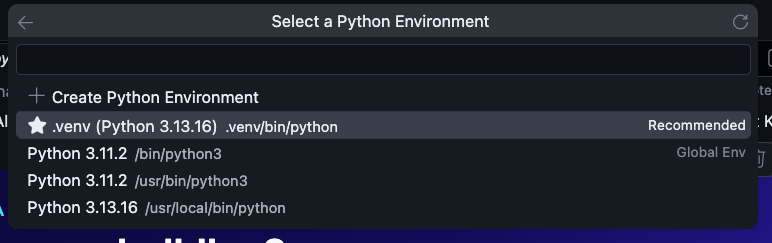
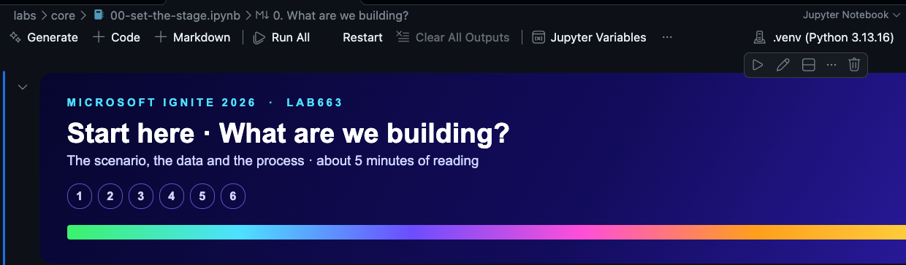

# Self-guided walkthrough

This is the full pass through the lab. We deploy once, then work through seven notebooks in order. Each notebook starts with a question, and ends with an "aha" that answers it.

> **Check the evidence, not just the happy path.** Historical BAMI results informed this revision, but they do not validate the changed workflow. Stale notebook outputs have been cleared. The [isolated rehearsal](../../docs/narrative.md#what-the-isolated-rehearsal-tells-us) still found router/file-search failures. When something differs from its **Expected** result, keep the exact message and run ID.

## Before we start

We need:

- A GitHub account with active Copilot access, signed into the Copilot experience in our editor.
- An Azure subscription where we can create resources and role assignments (Owner, or Contributor plus User Access Administrator).
- Quota for `gpt-5.4`, `gpt-5.4-mini`, the model router and the MAI image models in `eastus` or `westus`.
- This repo open in the dev container or a Codespace. It brings Python, the Azure CLI and Bicep.
- The repository's Python requirements, including `azure-ai-projects>=2.8.0`, and access to the preview rubric, insights and optimizer APIs. Notebook 01 stops if the SDK is too old.

Basic Python is helpful; previous agent or evaluation experience is not required. The required workflow stays in code. Portal views are optional.

Open Copilot Chat and ask it to explain a Python list comprehension before starting the timed lab.

**Expected:** Copilot answers without a missing-license or access-denied message. Our GitHub/Copilot sign-in and Azure sign-in are separate; a working Azure deployment does not verify Copilot access.

### If container setup reports missing Bicep

The container configuration enables Bicep installation alongside Azure CLI. If setup stops with `az bicep is not available`, rebuild the container using **Codespaces: Rebuild Container** in a Codespace or **Dev Containers: Rebuild Container** locally.

**Expected:** container setup reports a Bicep version and finishes successfully.

### Use the repository Python environment

The dev-container preparation action creates the root `.venv`, installs `requirements.txt` there, checks SDK capabilities and table rendering, and registers **Python (LAB663)**. Deployment uses that interpreter instead of whichever `python` happens to be on the terminal path.

For a prepared Windows checkout, create or update the environment before deploying:

```powershell
python -m venv .venv
.\.venv\Scripts\python.exe -m pip install -r requirements.txt
.\.venv\Scripts\python.exe .\src\check_environment.py --register-kernel
```

**Expected:** the environment check passes and **Python (LAB663)** is registered. A failed check stops kernel registration; no Azure resources are created. If VS Code already selected a system interpreter, use **Python: Select Interpreter** to choose `.venv`, and pick `.venv` in the notebook's kernel picker too; changing the workspace default does not replace an existing selection.

## Step 1: Deploy (this happens before the clock starts)

```bash
bash infra/deploy.sh
```

It asks for a subscription, region (`eastus` by default, or `westus`) and chat models, then builds our Foundry project in a fresh `rg-lab663-NNNN` resource group, eight model deployments (two chat models, four router editions and two image models), tracing, access, a `.env` file and our first agent, **v0**. Details are in [infra/README.md](../../infra/README.md).

**Expected:** it ends with `TrailMate v0 is ready.`

**If it fails:** send us the last few lines. A model missing from the region, or access that hasn't arrived yet, are the usual suspects.

**Before rerunning:** `deploy.sh` creates a fresh resource group every time, even with `--skip-agent`. If infrastructure succeeded but agent setup failed, rerun only `.venv/bin/python src/agent/01_build_agent.py` in the dev container, or `.\.venv\Scripts\python.exe .\src\agent\01_build_agent.py` on Windows. Preserve the existing `.env` and `.lab-state.json`; do not accidentally create another environment to repair a missing setting.

## Step 2: Work through the notebooks

Open each notebook in [`labs/core/`](../../labs/core/). Choose **Select Kernel** in the top-right corner and pick the starred **.venv** entry marked **Recommended**. This is the lab's prepared environment.



**Expected:** the top-right corner shows **.venv (Python 3.13.x)**.



Run one cell at a time with **Shift+Enter**. Keep the **Outline** view open: the numbered sections tell the story.

| Notebook | The question it starts with | Time | The aha |
|---|---|---|---|
| [00 · What are we building?](../../labs/core/00-set-the-stage.ipynb) | What are we building, and how will we know it got better? | pre-session reading | We're building a repeatable way to assess improvement |
| [01 · Set up and validate](../../labs/core/01-setup-and-validate.ipynb) | How do I know my setup really works? | 4 min | "It doesn't work" is useless. "Check 5 failed" is a fix |
| [02 · Choosing a model](../../labs/core/02-model-selection.ipynb) | Which model should I use? | 8 min | The real question is which of my questions need the big model |
| [03 · Multi-model vs multi-modal](../../labs/core/03-multi-model-vs-multimodal.ipynb) | What's the difference, and when do I need each? | 8 min | One is about what comes in, the other about who handles which step |
| [04 · Make it work](../../labs/core/04-make-it-work.ipynb) | How do I find what's wrong without reading every answer? | 12 min | Insights turn opinions into patterns with evidence |
| [05 · Make it better](../../labs/core/05-make-it-better.ipynb) | How do I know it got *better*, not just different? | 14 min target | A candidate must pass the checks before promotion |
| [06 · Make it optimal](../../labs/core/06-make-it-optimal.ipynb) | Can I cut my model bill without losing quality? | 14 min target | Complete evidence and verified prices matter more than a favorable average |

Notebooks 04, 05 and 06 share `.lab-state.json`, so run them in order, not concurrently. The file records pinned versions, dataset fingerprints and service job IDs. Raw evaluation evidence stays in the ignored `.lab-results` directory. Changing projects or frozen datasets requires preserving the old state and starting a new measurement.

The timing column is a planning budget, not a measured promise. The core uses one router edition; choose all four **before** starting Module 6 for a longer experiment. Reasoning-effort and full photo comparisons are optional. Do not cut cases or repeats to meet the clock.

A complete twelve-question, two-repeat baseline batch took 213 seconds in the isolated rehearsal. Module 5 runs several batches plus optimization, so its allocation needs a full timed rehearsal before delivery.

## While a service job runs

Each core notebook has a **While you wait** box next to its long-running cells. It needs no code, so it doesn't compete with the busy kernel, spend model quota or change the rubric.

**Expected:** progress and a saved run ID in the core notebook. A bounded wait may end while the service job continues. Resume that ID as the cell explains; do not repeatedly submit the batch. If requests fail, inspect the saved output, fix the cause, and explicitly select a new attempt.

## What to verify in our subscription

- **Feature access:** insights, rubric generation and the optimizer must work here, not only in the original BAMI environment.
- **Tracing:** a connection string is not proof of ingestion. Confirm the analysis actually saw the practice traces.
- **Evaluation inputs:** retrieval criteria need structured tool evidence. Inspect the judge's per-dimension reasons before trusting the aggregate.
- **Coverage:** every repeat must score all twelve questions. An incomplete batch cannot earn promotion.
- **Cost:** fill verified regional prices, source and date in `data/pricing.json` before claiming savings. Missing serving-model or cached-input prices remain unknown, not zero.
- **Timing:** record elapsed job time and request latency separately. A completed deployment alone does not validate the 60-minute learner journey.

## Step 3: Clean up

```bash
bash infra/cleanup.sh
```

It finds our resource group in `.env`, lists what's inside, and asks us to type the group's name to confirm. Then it deletes that one resource group and nothing else. Our local `.env` and `.lab-state.json` stay, and it's safe to delete them. Add `--purge` if we want the deleted Foundry resource purged too.

## What to tell us

- Where did we get stuck, and what did the message say?
- Did each notebook's **aha** land? Did we feel we learned something, or just clicked?
- Where was the text too long, too short, or too technical (or not technical enough)?
- How long did each notebook take?
- What did we expect to see that wasn't there?
