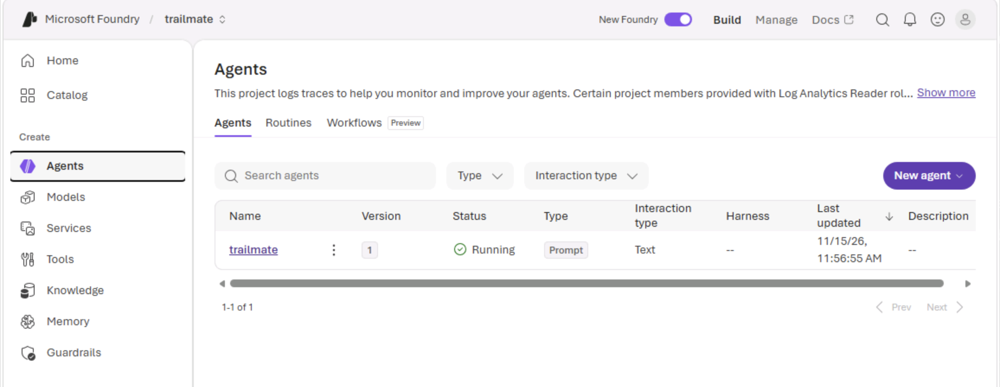
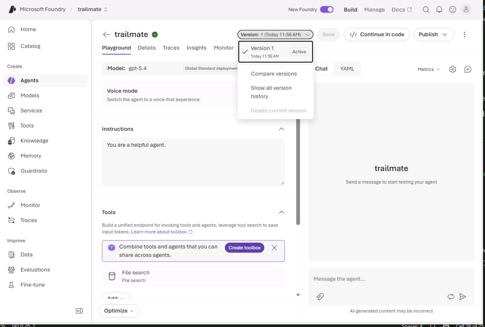

# 2.1 Meet TrailMate v0

**What we'll do:** Meet the agent we'll improve today. TrailMate is already deployed in Foundry. Let's see what it's made of and how it answers.

1. [] In Edge, switch to the **Foundry portal** tab. In the left menu, select **Agents**. You see one agent, **trailmate**.

    

1. [] Select **trailmate** to open its playground, then look at the left side:
    - **Version 1** is selected. That's our starting point, which we call **v0**.
    - The **Model** is **gpt-5.4**, a large frontier model.
    - The **Instructions** are just one line: "You are a helpful agent."
    - **File search** under **Tools** lets it search ten product manuals.

    

1. [] In **Message the agent**, ask a question about the manuals.

    ++Which tent sleeps 8 people, the TrailMaster X4 or the Alpine Explorer?++

1. [] Now ask one where agents often overclaim. The manual says **water-resistant**, not waterproof.

    ++Is the Summit Breeze Jacket waterproof?++

    <!-- TODO screenshot: 02-meet-01-v0-answers.png | The trailmate v0 playground with its answers to both questions -->

1. [] Decide for yourself: did TrailMate keep the word "water-resistant", or upgrade the claim?

> [!Knowledge] Building this agent was easy: one model, one tool, one line of instructions. Trusting it is harder. A customer who hears "waterproof" and gets soaked won't come back.

> [+Hint] Ask Copilot: what is this agent?
>
> ++What is a prompt agent in Microsoft Foundry, and what does its file search tool do? Answer in two sentences.++

---

> [!Note] **Success:** We just met TrailMate v0 and saw why "it answers" isn't the same as "it's reliable".
