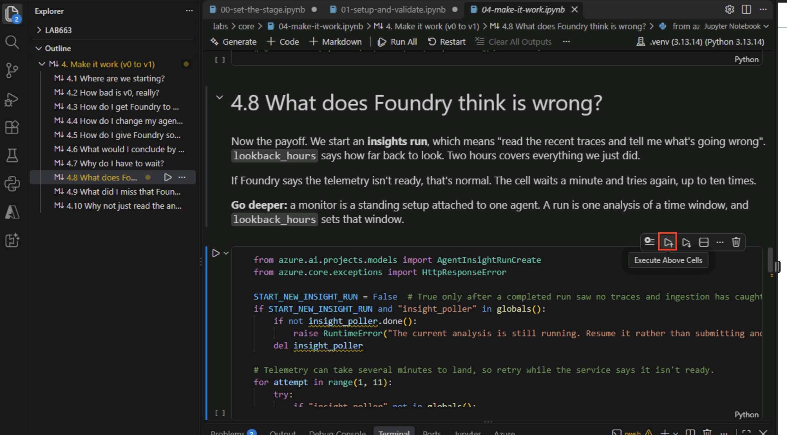

# 3.1 Create v1 and leave traces

**What we'll do:** Change one lever, the instructions, to create TrailMate **v1**, then ask it 12 practice questions so it leaves traces for Foundry to analyze. The optimizer on the next page learns from these.

1. [] In the Explorer, open **labs > core > 04-make-it-work.ipynb**.
1. [] Select the **.venv (3.13.14)** kernel, the same way as on page 1.3.
1. [] In the **Outline**, click **4.8 What does Foundry think is wrong?**, then click the first code cell below that heading.
1. [] Hover over that cell and click the **Execute Above Cells** icon in its toolbar. This runs sections 4.1 to 4.7 in order and stops before 4.8.

    

1. [] Wait for the cells to finish. It takes a couple of minutes, including a one-minute pause in section 4.7 so the traces can arrive.
1. [] Check the results in the Outline:
    - The first cell prints **Connected. 12 practice questions ready.**
    - Section **4.4** prints **Saved. TrailMate v1 is Foundry version** followed by a number.
    - Section **4.5** shows all 12 questions marked **done**.

    <!-- TODO screenshot: 03-kickoff-01-practice-done.png | Section 4.5 output with all 12 practice questions marked done -->

> [+Hint] Ask Copilot: what are traces?
>
> ++What are agent traces in Microsoft Foundry? Explain in one sentence.++

---

> [!Note] **Success:** We just created TrailMate v1 and gave Foundry 12 conversations' worth of traces to learn from.
