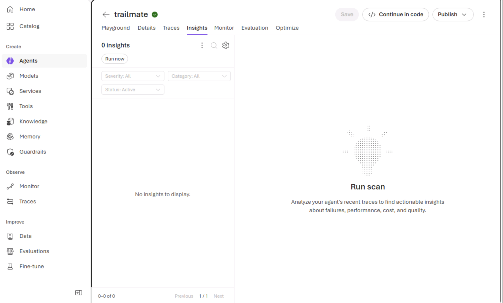

# 4.1 Start an insights run

**What we'll do:** Ask Foundry to read all of TrailMate's traces and find what's going wrong. It takes a few minutes, so we start it now and read the results on page 5.3.

> [!Knowledge] A trace records one answer. **Insights** read many traces at once and group the problems they find, with evidence. It's how we spot patterns no single answer shows.

1. [] In the Foundry portal, open **Agents** and select **trailmate**. It now uses **Version 2**, the v1 we created on page 3.1, marked **Active** in the **Version** menu. If the page was already open, it may still show Version 1 until you pick Version 2. Select the **Insights** tab.
1. [] Select **Run now** to scan the agent's recent traces for problems with failures, performance, cost, and quality.

    
    <!-- VERIFY: the learner role can start a run, and how long it takes. Fallback: run notebook 04 section 4.8. -->

1. [] Check that the analysis shows as running, then move on. We don't need to wait.

> [+Hint] Ask Copilot: what are insights?
>
> ++What do agent insights in Microsoft Foundry do? Explain in one sentence.++

---

> [!Note] **Success:** We just asked Foundry to look for problems across every TrailMate trace, while we keep learning.
