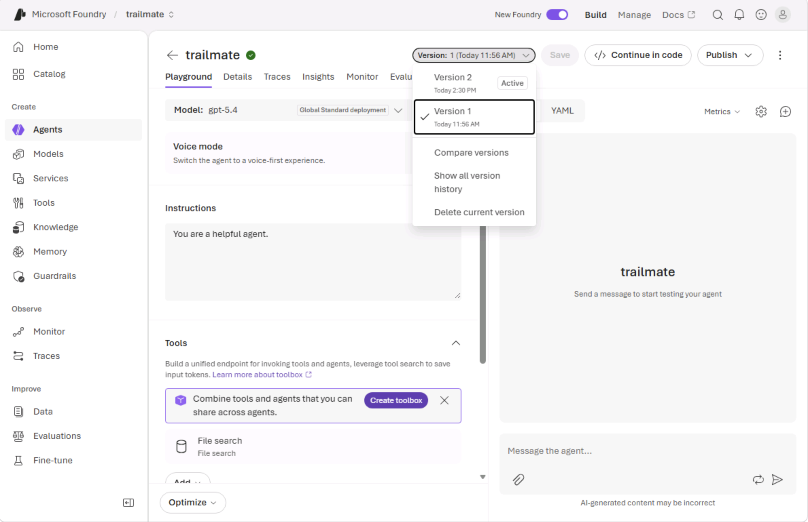
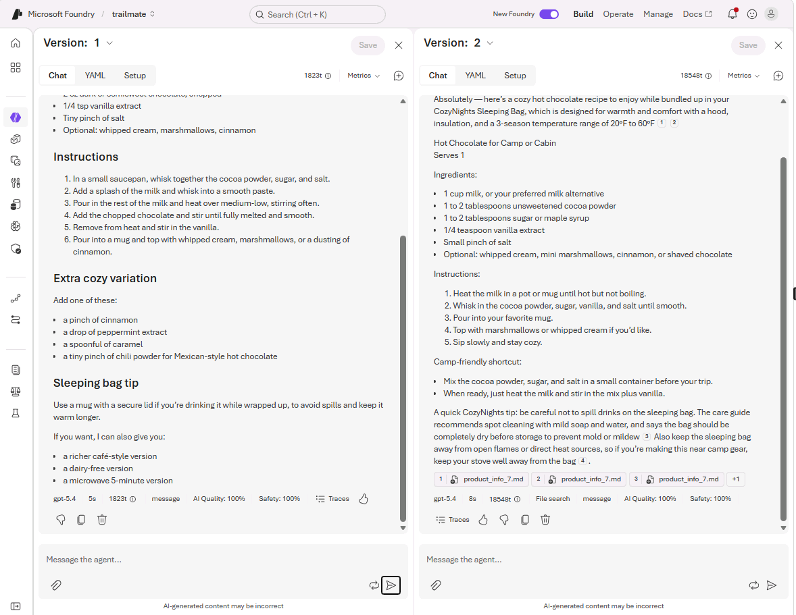

# 5.1 Compare v0 and v1

**What we'll do:** Put TrailMate v0 and v1 side by side in the playground, and see what better instructions changed.

1. [] In the Foundry portal, open **Agents** and select **trailmate**.
1. [] Open the **Version** menu at the top. You now see agent **Version 2**, our climb version **v1** from page 3.1, next to **Version 1**, our baseline **v0**.

    

1. [] In the same menu, select **Compare versions** and pick **Version 1** and **Version 2**.
1. [] Send the off-topic question from page 2.2 to both.

    ++Give me a recipe for hot chocolate I can drink while wrapped in my CozyNights Sleeping Bag.++

1. [] Compare the two answers. Did v1 stay closer to TrailMate's job?

    

    > [!Note] In our test, both versions still gave a recipe. v1 added grounded care tips from the manual, but it also searched the files and used about ten times the tokens. v1's instructions say to be helpful, not to stay in lane. Better instructions alone didn't fix this, and that's what the optimizer and our rubric are for.

> [!Knowledge] Later, the Agents list also shows **trailmate-optimizer-candidate** and **trailmate-mr-default-candidate**. They're test copies. Only a promotion changes **trailmate** itself.

> [+Hint] OPTIONAL - Ask Copilot: what did v1 change?
>
> ++Compare src/agent/instructions-v0.md with src/agent/instructions-v1.md. In three bullets, what changed and why might it help?++

---

> [!Note] **Success:** We just saw one lever, the instructions, change how TrailMate answers the same question.
