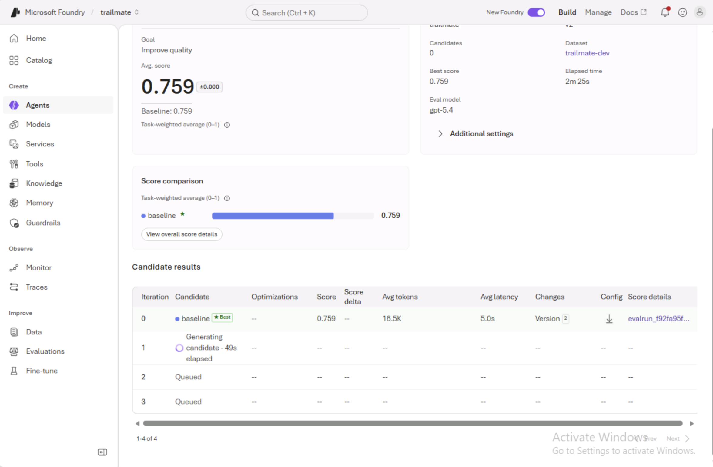

# 5.2 Check the monitor

**What we'll do:** Zoom out from one answer to all of them, then check on the optimizer.

1. [] On the trailmate agent page, open the **Monitor** tab.
1. [] Look at runs, token usage, and any failures. The 12 practice questions from page 3.1 are in here too.

    <!-- TODO screenshot: 05-work-02-monitor.png | The Monitor tab with agent runs and token usage -->
    <!-- VERIFY: Monitor tab location and whether data appears within a few minutes -->

1. [] Check on the optimizer. Select the **Optimize** tab and open our run. It first scores the baseline, our v1, then generates and scores candidates one at a time.

    

> [!Knowledge] Our agent works, but "works" isn't the same as "reliable". From here on we stop judging answers one at a time and start measuring them all.

> [+Hint] Ask Copilot: is the optimizer done?
>
> ++/microsoft-foundry What is the status of my latest agent optimization job for trailmate? Answer in one sentence. Do not change anything.++

---

> [!Note] **Success:** We just saw the whole agent at a glance and checked our optimizer is still climbing.
