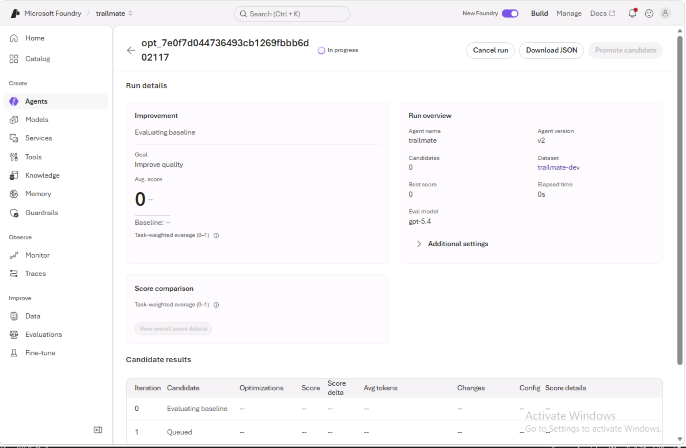
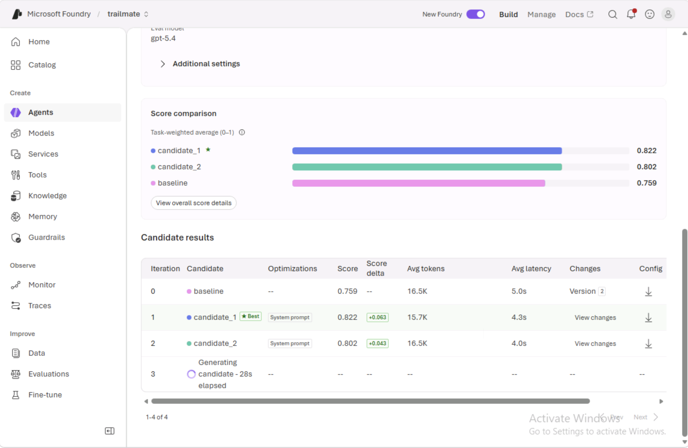

# 6.2 Let the optimizer climb

**What we'll do:** Pick up the optimizer job, read the instructions it proposed, and check that the winner isn't just more cautious.

1. [] In the Foundry portal, open **trailmate**, select the **Optimize** tab, and open our run. The details show the goal, the baseline score, and each candidate as it's scored.

    

1. [] Back in VS Code, jump to section **5.6** and run the job cell again. It resumes the saved job without starting a new one, and prints **Finished** with the best and baseline scores.

    <!-- TODO screenshot: 06-better-02-optimizer-finished.png | The optimizer cell printing Finished with best and baseline scores -->

    > [+Hint] Still running? Read our test run
    >
    > In our test, two candidates beat the v1 baseline of 0.759: candidate_1 scored 0.822 and candidate_2 scored 0.802. Each row also shows average tokens and latency, so we can see quality, cost, and speed together. Select **View changes** to see what a candidate rewrote.
    >
    > 

1. [] Jump to section **5.7** and run its two code cells. Read each candidate's score, then read the winning instructions in full.
1. [] Jump to section **5.8** and run its code cell. It stages the winner as a separate candidate agent. Nothing is promoted yet.
1. [] Jump to section **5.9** and run its code cell. Check the guard-case answers against the manual.

> [!Knowledge] A timid agent never invents anything, but it's also useless. Guard cases are questions the manuals *do* answer, so a candidate that just refuses fails them.

> [+Hint] Ask Copilot: what did the optimizer change?
>
> ++Summarize what the winning candidate changed in section 5.7 of labs/core/05-make-it-better.ipynb, in three bullets. Don't change any files.++

---

> [!Note] **Success:** We just read what the optimizer changed and checked it still answers what it should.
