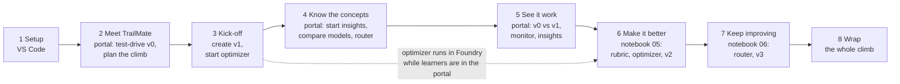

# LAB663 Skillable facilitator guide

This folder holds the in-venue version of LAB663. Learners follow a paged manual inside a Skillable lab. Their Foundry project, models, router editions, tracing and the starting TrailMate agent are prepared before they arrive. They never deploy or delete anything themselves.

This guide is for facilitators and maintainers. The learner manual is generated into [skillable-copy.md](skillable-copy.md) from the page files listed below.

## Overview

Building the first agent is easy. Keeping it reliable and cost-effective takes continuous improvement. In this lab we take **TrailMate**, an outdoor-gear support agent that answers from ten product manuals, through continuous improvement, one change at a time. The **climb** is the positive trend toward our goal: we change one lever per version and measure every version with the same frozen questions and rubric.

### The workflow



Learners meet the agent before they change it. Stage 2 shows TrailMate v0 in the portal, lets learners see citations, live evaluation scores and a trace, and try an off-topic request, and maps the climb from v0 to v3, including how our version names relate to Foundry's version numbers. The kick-off then starts the slowest step, the agent optimizer, so learners spend that wait in the portal learning the concepts. When they return to the notebooks, the job is likely finished. Every slow step also has a "while you wait" screenshot of a completed run, so a learner who runs out of time still sees the result.

### Stages at a glance

| Stage | Pages | Where | What learners do | Version | Target |
|:------|:------|:------|:-----------------|:--------|:-------|
| 0 Start | 0.1–0.2 | Skillable, VM, Edge | Sign in to the VM, GitHub, Foundry, and Azure portals; learn the page conventions | | 5 min |
| 1 Setup | 1.1–1.3 | VS Code | Check the status files, `az login`, Copilot Chat, run notebook 01 | | 8 min |
| 2 Meet TrailMate | 2.1–2.3 | Foundry portal | Inspect v0, turn on live metrics, ask two questions, read evaluations and a trace; read the plan and version map | v0 | 7 min |
| 3 Kick-off | 3.1–3.2 | VS Code | Create v1, send practice questions, save a starting gap list, start the optimizer | v1 | 8 min |
| 4 Know the concepts | 4.1–4.4 | Foundry portal | Start an insights run; compare `gpt-5.4` and `gpt-5.4-mini`; watch `mr-default`, `mr-cost` and `mr-quality` choose models | | 8 min |
| 5 See it work | 5.1–5.3 | Foundry portal | Compare v0 and v1 side by side, check the monitor, read the insights against our gaps | v1 | 7 min |
| 6 Make it better | 6.1–6.3 | Notebook 05 | Rubric, v0/v1 scores, optimizer candidates, promote or retain | v2 | 12 min |
| 7 Keep improving | 7.1–7.2 | Notebook 06 | Score `mr-default` against v2, then decide | v3 | 10 min |
| 8 Wrap | 8.1 | Notebook 06 | Read the whole-climb heatmap, end the lab | | 2 min |
| 9 More | 9.1–9.2 | Notebooks | Optional: multi-model vs multi-modal, MAI models | | |
| 10 Reference | 10.1 | | Credentials and links | | |

The targets add up to about 67 minutes. They are planning targets, not measured times. The second dry run measures them.

### Version names

We use two terms. **Climb versions** (v0 to v3) are the steps of our climb, and the notebooks use them. **Agent versions** (Version 1, Version 2, ...) are what Foundry has deployed, numbered from 1 per agent. Pages that show the portal name both.

| Climb version | Agent version in Foundry |
|:---------|:--------|
| v0 | `trailmate` Version 1 |
| v1 | `trailmate` Version 2, printed by notebook 04 section 4.4 |
| v2 | Staged as `trailmate-optimizer-candidate`; a promotion adds the next `trailmate` version |
| v3 | Staged as `trailmate-mr-default-candidate`; a promotion adds the next `trailmate` version |

### Hero products

| Product | What it does in this lab | Learn more |
|:--------|:-------------------------|:-----------|
| **Microsoft Foundry** | Hosts our project, models, the TrailMate agent, evaluations and traces | [What is Microsoft Foundry?](https://learn.microsoft.com/azure/foundry/what-is-foundry) |
| **Foundry playgrounds** | Compare mode sends one prompt to several models side by side, showing answers, latency and tokens (pages 2.1–2.2, 4.2–4.4, 5.1) | [Microsoft Foundry playgrounds](https://learn.microsoft.com/azure/foundry/concepts/concept-playgrounds) |
| **Model router** | One deployment that picks a model per request. Its routing mode (balanced, cost, quality) sets the cost/quality dial (pages 4.3, 4.4, 7.1) | [Model router](https://learn.microsoft.com/azure/foundry/openai/concepts/model-router), [Model router with agents](https://learn.microsoft.com/azure/foundry/openai/how-to/model-router-agents) |
| **Tracing** | Records each step of an answer: file search, retrieved passages, tokens, latency (page 2.2) | [Set up tracing](https://learn.microsoft.com/azure/foundry/observability/how-to/trace-agent-setup) |
| **Insights** | Analyzes many traces at once and groups problems into findings with evidence. Learners start a run from the portal and read it later (pages 4.1, 5.3) | [Use Insights in Foundry](https://learn.microsoft.com/azure/foundry/observability/how-to/agent-insights) |
| **Rubric evaluators** | An AI judge with a checklist, drafted from our traces and gap list (pages 3.2, 6.1) | [Rubric evaluators](https://learn.microsoft.com/azure/foundry/concepts/evaluation-evaluators/rubric-evaluators) |
| **Agent optimizer** | Rewrites the agent's instructions, scores candidates with our rubric, and reports the best (pages 2.3, 3.2, 6.2) | [What is the agent optimizer?](https://learn.microsoft.com/azure/foundry/agents/concepts/agent-optimizer-overview) |
| **GitHub Copilot with the Microsoft Foundry skill** | Explains errors and results, and can query our Foundry project from chat (Copilot prompts throughout) | [Use the Microsoft Foundry skill](https://learn.microsoft.com/azure/foundry/how-to/develop/use-microsoft-foundry-skill) |

## Before the session

The lab profile must give every learner these before the lab starts. Learners don't install or clone anything.

| Learner needs | Provided by |
|:--------------|:------------|
| A Windows 11 VM (`Win11-Pro-Base`) with VS Code, the LAB663 folder on the desktop, and a prepared `.venv` kernel (`.venv (3.13.14) (Python 3.13.14)`, selected via Select Kernel > Python Environments) | The VM image |
| A Foundry project with `gpt-5.4`, `gpt-5.4-mini`, the four `mr-` router editions, tracing, the v0 TrailMate agent, and `.env` | [Lifecycle scripts](../../skillable_lifecycles/README.md), which write `LAB663-deployment-output.txt` (summary) and `lab663-deploy-<timestamp>.txt` (run log) to the desktop |
| GitHub Enterprise sign-in at `https://github.com/enterprises/skillable-events/sso` with the learner's Azure credentials | The Skillable GitHub/Copilot lifecycle |
| `@lab.CloudPortalCredential(User1)` Username, Password and AccessToken, and `@lab.CloudSubscription.TenantId` | The lab profile |

## Running the session

- **Support model.** Learners ask Copilot first, using the **Ask Copilot** hint on the page, then raise a hand and say the page and step, for example "page 6.2, step 4". Page 1.2 checks that Copilot and the Foundry skill work before anyone needs them.
- **Notebook sections vs page numbers.** Page numbers (like **6.2**) are the manual's. Notebook sections (like **section 4.8**) belong to the notebook. Pages always name both.
- **Kick-off gap list.** Page 3.2 supplies three gaps as copy text so the optimizer can start early. They're written as risks to check, not observed results. Page 5.3 has learners compare them with Foundry's insights.
- **Stopping the optimizer wait.** On page 6.1, learners stop the waiting cell if the optimizer is still running, so they can score v0 and v1. The job keeps running in Foundry, and page 6.2 resumes it from the saved ID.
- **Promote in the notebook only.** The portal's Optimize tab has a **Promote candidate** button. Learners don't use it: notebook section 5.12 promotes only after the held-out check, and notebook 06 reads the result. Page 6.2 says so. If someone promotes in the portal anyway, the agent gains an extra version, and 5.12 may promote again.
- **Optimizer cost.** In our dry run the optimizer job used about 1.9 million tokens, an estimated $5.37, above the notebook's $4.88 ceiling estimate. It took about 10 minutes.
- **Retaining is a valid outcome.** At 6.3 and 7.2 the notebooks may keep the earlier version. That's a correct result, not a failure.
- **Never deploy or clean up.** Learners never run `infra/deploy.sh` or `infra/cleanup.sh`. Skillable removes the resources when the lab ends.

### Known risks to watch in the dry run

| Risk | Where | What to check |
|:-----|:------|:--------------|
| Rubric generation runs before traces have landed | 3.2 | Whether section 5.2 succeeds after the 60-second pause in section 4.7 |
| Version confusion in the portal | 2.1, 5.1 | Version 1 is v0 and Version 2 is v1; whether **Compare versions** supports side-by-side chat |
| Router picks don't differ | 4.4 | Whether `mr-cost` and `mr-quality` choose different models for the tent prompt |
| Evaluation runs are slow | 6.1, 6.3, 7.1 | Real durations. An isolated rehearsal measured 213 seconds for one evaluation pair. |
| Optimizer duration | 3.2, 6.2 | Whether it finishes before learners return from the portal |
| Insights from the portal | 4.1, 5.3 | Whether learners can start an analysis from the Insights tab, and whether it finishes by page 5.3. Fallback: notebook 04 section 4.8 |

Each page also carries `<!-- VERIFY: ... -->` comments for these checks. They don't render in Skillable.

## Page files

Each file is one Skillable page holding one small task. Files are named `NN-stage-NN.md`, and the name order sets the page order.

| File | Page title |
|:-----|:-----------|
| [00-start-01.md](00-start-01.md) | 0.1 Sign in to your lab |
| [00-start-02.md](00-start-02.md) | 0.2 How this lab works |
| [01-setup-01.md](01-setup-01.md) | 1.1 Set up the local environment |
| [01-setup-02.md](01-setup-02.md) | 1.2 Set up GitHub Copilot Chat |
| [01-setup-03.md](01-setup-03.md) | 1.3 Validate the Azure environment |
| [02-meet-01.md](02-meet-01.md) | 2.1 Meet TrailMate v0 |
| [02-meet-02.md](02-meet-02.md) | 2.2 Test-drive TrailMate v0 |
| [02-meet-03.md](02-meet-03.md) | 2.3 Plan the climb |
| [03-kickoff-01.md](03-kickoff-01.md) | 3.1 Create v1 and leave traces |
| [03-kickoff-02.md](03-kickoff-02.md) | 3.2 Start the optimizer |
| [04-concepts-01.md](04-concepts-01.md) | 4.1 Start an insights run |
| [04-concepts-02.md](04-concepts-02.md) | 4.2 Under the hood: model selection |
| [04-concepts-03.md](04-concepts-03.md) | 4.3 Let a router choose |
| [04-concepts-04.md](04-concepts-04.md) | 4.4 Turn the cost-quality dial |
| [05-work-01.md](05-work-01.md) | 5.1 Compare v0 and v1 |
| [05-work-02.md](05-work-02.md) | 5.2 Check the monitor |
| [05-work-03.md](05-work-03.md) | 5.3 Read the insights |
| [06-better-01.md](06-better-01.md) | 6.1 Turn good into a number |
| [06-better-02.md](06-better-02.md) | 6.2 Let the optimizer climb |
| [06-better-03.md](06-better-03.md) | 6.3 Decide whether to promote |
| [07-improve-01.md](07-improve-01.md) | 7.1 Try a model router |
| [07-improve-02.md](07-improve-02.md) | 7.2 Decide on the router |
| [08-wrap-01.md](08-wrap-01.md) | 8.1 Finish the lab |
| [09-more-01.md](09-more-01.md) | 9.1 More: multi-model vs multi-modal |
| [09-more-02.md](09-more-02.md) | 9.2 More: explore MAI models |
| [10-ref-01.md](10-ref-01.md) | 10.1 Lab credentials and links |

The core path skips notebook 00 (its story is on page 0.2) and notebook 02 (pages 4.2–4.4 cover it in the portal). Notebook 03 is in the More labs. Learners also skip notebook 04 sections 4.8–4.10, because insights run from the portal; running 4.8 would start a second analysis.

## Maintaining the manual

### Page conventions

- Title: `# N.N Title`, 40 characters or fewer. It labels the **Next** button.
- First line: `**What we'll do:** ...`. Last line: `> [!Note] **Success:** We just ...`.
- One small task per page, `1. []` checkbox steps, and few blocks. Help goes in collapsible `> [+Hint]` blocks, including **Copilot prompt** blocks.
- Syntax follows [Creating instructions with Markdown syntax](https://docs.skillable.com/docs/creating-instructions-with-markdown-syntax).

### Screenshots

Pages mark each needed screenshot with a comment:

```markdown
<!-- TODO screenshot: 04-concepts-01-compare-setup.png | The model playground in compare view -->
```

After a dry run, save the capture under [screenshots/](screenshots/) with that file name and replace the comment with an image line that uses the same alt text:

```markdown

```

### Build and publish the manual

Skillable loads the pages live from the public repo [nitya/skillable-labs](https://github.com/nitya/skillable-labs/tree/ignite26-lab663/ignite26-lab663/v1) (branch `ignite26-lab663`, folder `ignite26-lab663/v1`). After any page or screenshot change:

1. Clone the public repo next to this one and check out its `ignite26-lab663` branch.
1. Run the generator with `PUBLISH_DIR` pointing at the published folder:

    ```bash
    PUBLISH_DIR=../skillable-labs/ignite26-lab663/v1 bash instructions/skillable/scripts/generate-skillable-copy.sh
    ```

1. Commit and push the public repo.
1. If the page list changed, paste [skillable-include.md](skillable-include.md) into the lab profile (**Edit Instructions**) again. Otherwise Skillable picks up the new content on its own.

The generator writes three files here, all starting with `@lab.Title` and joined by `===` page breaks:

| File | Contents | Use it |
|:-----|:---------|:-------|
| [skillable-include.md](skillable-include.md) | One `[!include]` per page, pulled live from the public repo | **The normal way.** Paste once into **Edit Instructions** |
| [skillable-copy.md](skillable-copy.md) | Every page's full text, images from the public repo | Paste as a static snapshot instead of includes |
| [skillable-copy-images.md](skillable-copy-images.md) | Every page's full text, each image as `<!-- IMAGE: file \| alt -->` | When images must be uploaded to the profile by hand |

With `PUBLISH_DIR` set, it also writes the published folder: each page with its image links rewritten to raw URLs (relative links don't load inside a Skillable include), the `screenshots/` folder, and `skillable-include.md`. To publish somewhere else, set `PUBLISH_REPO`, `PUBLISH_BRANCH` and `PUBLISH_PATH`.

Once screenshots are uploaded to the Skillable profile, add each one to the `SKILLABLE_MEDIA` table in the [generator](scripts/generate-skillable-copy.sh). Both files then use the uploaded `!IMAGE[...]` path automatically, so you don't have to re-insert them after every regeneration.
