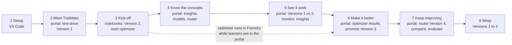

# LAB663 Skillable facilitator guide

This folder holds the in-venue version of LAB663. Learners follow a paged manual inside a Skillable lab. Their Foundry project, models, router editions, tracing and the starting TrailMate agent are prepared before they arrive. They never deploy or delete anything themselves.

This guide is for facilitators and maintainers. The learner manual is generated into [skillable-copy.md](skillable-copy.md) from the page files listed below.

## Overview

Building the first agent is easy. Keeping it reliable and cost-effective takes continuous improvement. In this lab we take **TrailMate**, an outdoor-gear support agent that answers from ten product manuals, through continuous improvement, one change at a time. The **climb** is the positive trend toward our goal: we change one lever per version and measure every version with the same frozen questions and rubric.

### The workflow



Learners meet the agent before they change it. Stage 2 shows TrailMate Version 1 in the portal, lets learners see citations, live evaluation scores and a trace, and try an off-topic request, then maps the climb from Version 1 to Version 4. The kick-off is the only notebook work in the core path: it creates Version 2 and starts the slowest step, the agent optimizer, so learners spend that wait in the portal learning the concepts. Everything after the kick-off happens in the portal: reading and promoting the optimizer's winner as Version 3, switching it to the model router as Version 4, and scoring Version 4 with our rubric. The deeper, notebook-driven measurement (held-out questions, repeated runs, all router editions) is the More lab on page 9.2.

### Stages at a glance

| Stage | Pages | Where | What learners do | Agent version | Target |
|:------|:------|:------|:-----------------|:--------------|:-------|
| 0 Start | 0.1–0.2 | Skillable, VM, Edge | Sign in to the VM, GitHub, Foundry, and Azure portals; learn the page conventions | | 5 min |
| 1 Setup | 1.1–1.3 | VS Code | Check the status files, `az login`, Copilot Chat, run notebook 01 | | 8 min |
| 2 Meet TrailMate | 2.1–2.3 | Foundry portal | Inspect Version 1, turn on live metrics, ask two questions, read evaluations and a trace; read the plan | Version 1 | 7 min |
| 3 Kick-off | 3.1–3.2 | VS Code | Create Version 2, send practice questions, save a starting gap list, view the rubric, start the optimizer | Version 2 | 10 min |
| 4 Know the concepts | 4.1–4.4 | Foundry portal | Start an insights run; compare `gpt-5.4` and `gpt-5.4-mini`; watch `mr-default`, `mr-cost` and `mr-quality` choose models and compare cost | | 9 min |
| 5 See it work | 5.1–5.3 | Foundry portal | Compare Versions 1 and 2, check the monitor, read the insights against our gaps | Version 2 | 7 min |
| 6 Make it better | 6.1–6.2 | Foundry portal | Read the optimizer results, promote the winner, compare Versions 1 and 3 | Version 3 | 6 min |
| 7 Keep improving | 7.1–7.3 | Foundry portal | Switch to the model router, compare Versions 3 and 4, score Version 4 with our rubric, read the router's cost | Version 4 | 10 min |
| 8 Wrap | 8.1 | Foundry portal | Review Versions 1 to 4, end the lab | | 2 min |
| 9 More | 9.1–9.2 | Notebooks | Optional: MAI models, measure in code | | |

The targets add up to about 64 minutes. They are planning targets, not measured times. The second dry run measures them.

### Version names

Pages use Foundry's **agent versions**: Version 1, 2, 3 and 4 of the `trailmate` agent. Each one changes a single lever. The notebooks print their own labels, `v0` and `v1` for Versions 1 and 2, and pages that quote notebook output say so.

| Agent version | One lever | Created by |
|:--------------|:----------|:-----------|
| Version 1 | Starting point | Lifecycle setup |
| Version 2 | Hand-written instructions | Notebook 04 section 4.4 (page 3.1) |
| Version 3 | Optimizer-rewritten instructions | **Promote candidate** in the portal (page 6.2) |
| Version 4 | Model changed to `mr-default` | **Save** in the playground (page 7.1) |

### Hero products

| Product | What it does in this lab | Learn more |
|:--------|:-------------------------|:-----------|
| **Microsoft Foundry** | Hosts our project, models, the TrailMate agent, evaluations and traces | [What is Microsoft Foundry?](https://learn.microsoft.com/azure/foundry/what-is-foundry) |
| **Foundry playgrounds** | Compare mode sends one prompt to several models side by side, showing answers, latency and tokens (pages 2.1–2.2, 4.2–4.4, 5.1, 6.2, 7.2) | [Microsoft Foundry playgrounds](https://learn.microsoft.com/azure/foundry/concepts/concept-playgrounds) |
| **Model router** | One deployment that picks a model per request. Its routing mode (balanced, cost, quality) sets the cost/quality dial (pages 4.3, 4.4, 7.1–7.3) | [Model router](https://learn.microsoft.com/azure/foundry/openai/concepts/model-router), [Model router with agents](https://learn.microsoft.com/azure/foundry/openai/how-to/model-router-agents) |
| **Tracing** | Records each step of an answer: file search, retrieved passages, tokens, latency (page 2.2) | [Set up tracing](https://learn.microsoft.com/azure/foundry/observability/how-to/trace-agent-setup) |
| **Insights** | Analyzes many traces at once and groups problems into findings with evidence. Learners start a run from the portal and read it later (pages 4.1, 5.3) | [Use Insights in Foundry](https://learn.microsoft.com/azure/foundry/observability/how-to/agent-insights) |
| **Rubric evaluators** | An AI judge with a checklist, drafted from our traces and gap list (pages 3.2, 6.1, 7.3) | [Rubric evaluators](https://learn.microsoft.com/azure/foundry/concepts/evaluation-evaluators/rubric-evaluators) |
| **Agent optimizer** | Rewrites the agent's instructions, scores candidates with our rubric, and reports the best (pages 2.3, 3.2, 6.1, 6.2) | [What is the agent optimizer?](https://learn.microsoft.com/azure/foundry/agents/concepts/agent-optimizer-overview) |
| **GitHub Copilot with the Microsoft Foundry skill** | Explains errors and results, and can query our Foundry project from chat (Copilot prompts throughout) | [Use the Microsoft Foundry skill](https://learn.microsoft.com/azure/foundry/how-to/develop/use-microsoft-foundry-skill) |

## Before the session

The lab profile must give every learner these before the lab starts. Learners don't install or clone anything.

| Learner needs | Provided by |
|:--------------|:------------|
| A Windows 11 VM (`Win11-Pro-Base`) with VS Code, the LAB663 folder on the desktop, and a prepared `.venv` kernel (`.venv (3.13.14) (Python 3.13.14)`, selected via Select Kernel > Python Environments) | The VM image |
| A Foundry project with `gpt-5.4`, `gpt-5.4-mini`, the four `mr-` router editions, tracing, the TrailMate agent (Version 1), and `.env` | [Lifecycle scripts](../../skillable_lifecycles/README.md), which write `LAB663-deployment-output.txt` (summary) and `lab663-deploy-<timestamp>.txt` (run log) to the desktop |
| GitHub Enterprise sign-in at `https://github.com/enterprises/skillable-events/sso` with the learner's Azure credentials | The Skillable GitHub/Copilot lifecycle |
| `@lab.CloudPortalCredential(User1)` Username, Password and AccessToken, and `@lab.CloudSubscription.TenantId` | The lab profile |

## Running the session

- **Support model.** Learners ask Copilot first, using the **Ask Copilot** hint on the page, then raise a hand and say the page and step, for example "page 6.2, step 4". Page 1.2 checks that Copilot and the Foundry skill work before anyone needs them.
- **Notebook sections vs page numbers.** Page numbers (like **6.2**) are the manual's. Notebook sections (like **section 4.8**) belong to the notebook. Pages always name both.
- **Kick-off gap list.** Page 3.2 supplies three gaps as copy text so the optimizer can start early. They're written as risks to check, not observed results. Page 5.3 has learners compare them with Foundry's insights.
- **Promote in the portal.** Page 6.2 promotes the optimizer's best candidate with **Promote candidate**, which makes Version 3. Page 7.1 changes Version 3's model to `mr-default` and saves Version 4. Learners don't run notebook 05 beyond section 5.6 or notebook 06 in the core path.
- **Optimizer cost.** In our dry run the optimizer job used about 1.9 million tokens, an estimated $5.37, above the notebook's $4.88 ceiling estimate. It took about 10 minutes.
- **SDK warning.** The optimizer cell may print "Ran into a deserialization error. Ignoring since this is failsafe deserialization". It's an Azure SDK warning about an empty reply body, and it's safe to ignore if the run finished on the Optimize tab.
- **Results vary.** Insights, rubric dimensions, candidate scores and router picks differ per run. A different candidate may win, or none may. Keeping a version is a correct result, not a failure.
- **Never deploy or clean up.** Learners never run `infra/deploy.sh` or `infra/cleanup.sh`. Skillable removes the resources when the lab ends.

### Known risks to watch in the dry run

| Risk | Where | What to check |
|:-----|:------|:--------------|
| Rubric generation runs before traces have landed | 3.2 | Whether section 5.2 succeeds after the 60-second pause in section 4.7. In our dry run it took 1 minute 47 seconds and worked first time |
| Optimizer duration | 3.2, 6.1 | Whether it finishes before learners return from the portal. About 10 minutes in our dry run |
| Saving a model change | 7.1 | Whether **Save** after changing the model creates Version 4 rather than overwriting Version 3 |
| Router model shown in agent answers | 7.2 | Whether the row under a router agent's answer names the routed model |
| Portal evaluation of Version 4 | 7.3 | Whether the agent version can be chosen, the custom rubric is listed, and how long the run takes |
| Notebook 06 section 6.3 | 9.2 | It returned a 400 error in our dry run; the More page says to skip it |

Each page also carries `<!-- VERIFY: ... -->` comments for these checks. They don't render in Skillable.

## Page files

Each file is one Skillable page holding one small task. Files are named `NN-stage-NN.md`, and the name order sets the page order.

| File | Page title |
|:-----|:-----------|
| [00-start-01.md](00-start-01.md) | 0.1 Sign in to your lab |
| [00-start-02.md](00-start-02.md) | 0.2 How this lab works |
| [01-setup-01.md](01-setup-01.md) | 1.1 Set up the local environment |
| [01-setup-02.md](01-setup-02.md) | 1.2 Set up GitHub Copilot Chat |
| [01-setup-03.md](01-setup-03.md) | 1.3 Validate the Azure environment |
| [02-meet-01.md](02-meet-01.md) | 2.1 Meet TrailMate |
| [02-meet-02.md](02-meet-02.md) | 2.2 Test-drive TrailMate |
| [02-meet-03.md](02-meet-03.md) | 2.3 Plan the climb |
| [03-kickoff-01.md](03-kickoff-01.md) | 3.1 Create Version 2 |
| [03-kickoff-02.md](03-kickoff-02.md) | 3.2 Start the optimizer |
| [04-concepts-01.md](04-concepts-01.md) | 4.1 Start an insights run |
| [04-concepts-02.md](04-concepts-02.md) | 4.2 Under the hood: model selection |
| [04-concepts-03.md](04-concepts-03.md) | 4.3 Let a router choose |
| [04-concepts-04.md](04-concepts-04.md) | 4.4 Turn the cost-quality dial |
| [05-work-01.md](05-work-01.md) | 5.1 Compare Versions 1 and 2 |
| [05-work-02.md](05-work-02.md) | 5.2 Check the monitor |
| [05-work-03.md](05-work-03.md) | 5.3 Read the insights |
| [06-better-01.md](06-better-01.md) | 6.1 Read the optimizer results |
| [06-better-02.md](06-better-02.md) | 6.2 Promote the winner |
| [07-improve-01.md](07-improve-01.md) | 7.1 Switch to the model router |
| [07-improve-02.md](07-improve-02.md) | 7.2 Compare with and without the router |
| [07-improve-03.md](07-improve-03.md) | 7.3 Score the router and its cost |
| [08-wrap-01.md](08-wrap-01.md) | 8.1 Finish the lab |
| [09-more-01.md](09-more-01.md) | 9.1 More: explore MAI models |
| [09-more-02.md](09-more-02.md) | 9.2 More: measure the climb in code |

The core path uses notebooks only for setup (01) and the kick-off (04 sections 4.1–4.9, 05 sections 5.1–5.6). It skips notebook 00 (its story is on page 0.2), notebook 02 (pages 4.2–4.4 cover it in the portal) and notebook 04 sections 4.8 and 4.10, because insights run from the portal. Notebook 05 sections 5.5 and 5.7–5.12, notebook 06 and notebook 03 are More labs.

## Maintaining the manual

### Page conventions

- Title: `# N.N Title`, 40 characters or fewer. It labels the **Next** button.
- First line: `**What we'll do:** ...`. Last line: `> [!Note] **Success:** We just ...`.
- One small task per page, `1. []` checkbox steps, and few blocks. Help goes in collapsible `> [+Hint]` blocks, including **Copilot prompt** blocks.
- Syntax follows [Creating instructions with Markdown syntax](https://docs.skillable.com/docs/creating-instructions-with-markdown-syntax).

### Screenshots

Pages mark each needed screenshot with a comment:

```markdown
<!-- TODO screenshot: 04-concepts-01-compare-setup.png | The model playground in compare view -->
```

After a dry run, save the capture under [screenshots/](screenshots/) with that file name and replace the comment with an image line that uses the same alt text:

```markdown

```

### Build and publish the manual

Skillable loads the pages live from the public repo [nitya/skillable-labs](https://github.com/nitya/skillable-labs/tree/ignite26-lab663/ignite26-lab663/v1) (branch `ignite26-lab663`, folder `ignite26-lab663/v1`). After any page or screenshot change:

1. Clone the public repo next to this one and check out its `ignite26-lab663` branch.
1. Run the generator with `PUBLISH_DIR` pointing at the published folder:

    ```bash
    PUBLISH_DIR=../skillable-labs/ignite26-lab663/v1 bash instructions/skillable/scripts/generate-skillable-copy.sh
    ```

1. Commit and push the public repo.
1. If the page list changed, paste [skillable-include.md](skillable-include.md) into the lab profile (**Edit Instructions**) again. Otherwise Skillable picks up the new content on its own.

The generator writes three files here, all starting with `@lab.Title` and joined by `===` page breaks:

| File | Contents | Use it |
|:-----|:---------|:-------|
| [skillable-include.md](skillable-include.md) | One `[!include]` per page, pulled live from the public repo | **The normal way.** Paste once into **Edit Instructions** |
| [skillable-copy.md](skillable-copy.md) | Every page's full text, images from the public repo | Paste as a static snapshot instead of includes |
| [skillable-copy-images.md](skillable-copy-images.md) | Every page's full text, each image as `<!-- IMAGE: file \| alt -->` | When images must be uploaded to the profile by hand |

With `PUBLISH_DIR` set, it also writes the published folder: each page with its image links rewritten to raw URLs (relative links don't load inside a Skillable include), the `screenshots/` folder, and `skillable-include.md`. To publish somewhere else, set `PUBLISH_REPO`, `PUBLISH_BRANCH` and `PUBLISH_PATH`.

Once screenshots are uploaded to the Skillable profile, add each one to the `SKILLABLE_MEDIA` table in the [generator](scripts/generate-skillable-copy.sh). Both files then use the uploaded `!IMAGE[...]` path automatically, so you don't have to re-insert them after every regeneration.
